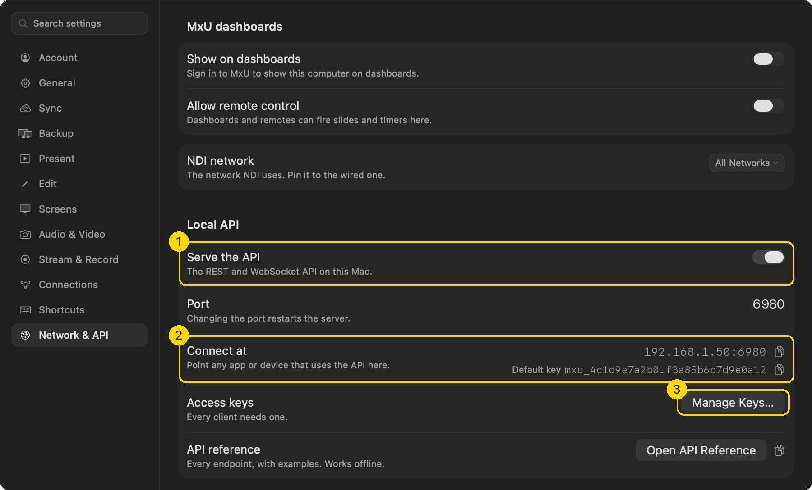
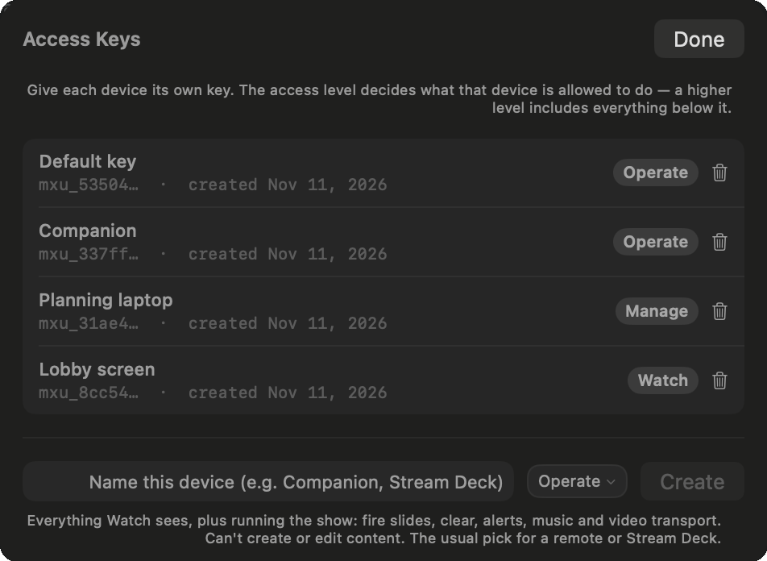
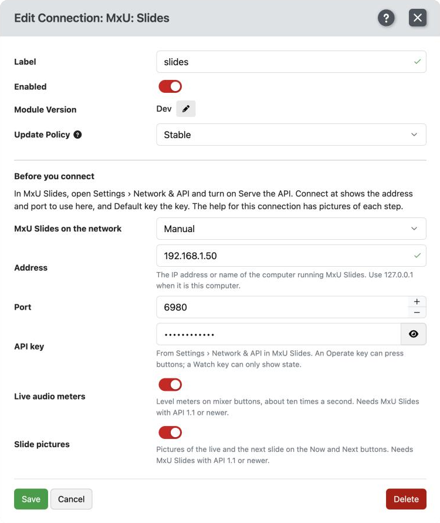
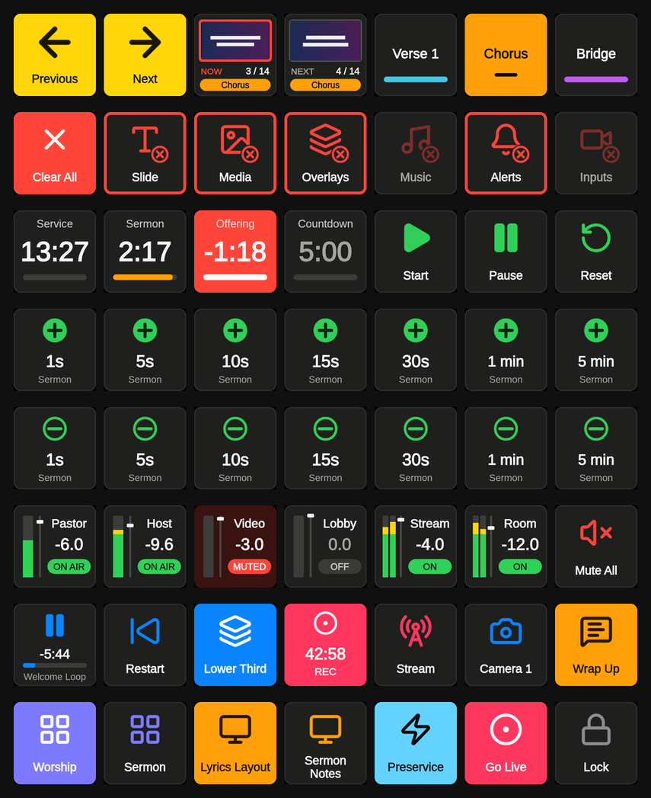

## MxU Slides

Control [MxU Slides](https://getmxu.com), the presentation app for churches and live events, from a Stream Deck or any other surface: slides and sections, clears, timers, media, overlays, alerts, music, the audio mixer with live meters, screens, recording and streaming.

The module keeps one live connection to MxU Slides. Buttons and variables follow the app the moment something changes there, and lists (timers, Action Combos, overlays, mixer strips and so on) refresh when the library does.

## Requirements

- MxU Slides on a Mac on the same network (or the same computer).
- Companion 5.0 or newer.
- Most of the module works with any MxU Slides that has the Local API. The parts marked **1.1** below need a MxU Slides with API 1.1 or newer. Against an older one those actions do nothing and write one line to the log: "needs a newer MxU Slides".

## Setup

### 1. Turn on the API in MxU Slides

In MxU Slides, open **Settings › Network & API**.

1. Turn on **Serve the API**.
2. **Connect at** shows the address and port to use in Companion. **Default key** is a key that can run the show; the button beside it copies it.
3. To give Companion a key of its own, open **Manage Keys…**

### 2. Pick a key

Every device that connects needs a key. In **Manage Keys…**, name the device, pick **Operate** and press **Create**. The key is shown once, so copy it then.

| Key     | What it can do                                                                           |
| ------- | ---------------------------------------------------------------------------------------- |
| Watch   | See what is live. Feedbacks and variables work; buttons that change anything do not.     |
| Operate | Everything Watch sees, plus running the show. **This is the one to use with Companion.** |
| Manage  | Everything Operate does, plus creating and editing content. The module does not need it. |

### 3. Add the connection in Companion

Add a **MxU: Slides** connection and fill it in:

- **MxU Slides on the network** lists every MxU Slides that has its API turned on. Pick yours, or leave it on **Manual** and type the **Address** and **Port** from _Connect at_ in MxU Slides. When MxU Slides runs on the same computer as Companion, the address is `127.0.0.1`.
- **API key**: paste the key.
- **Live audio meters** and **Slide pictures** can be turned off if you do not use them. **1.1**

The connection shows **OK** once it is connected. If the key is a Watch key it says so, and buttons will not act until you give it an Operate key.

## Presets

Open the **Presets** tab and pick the connection. Every preset is drawn to fit the whole key, with Companion's top bar on or off.

Buttons are dark when they are not in use and filled with their color while live. The clear buttons are the exception: a slide is up for most of a service, so they stay dark, dim while there is nothing to clear and bright with a ring while there is. Clear All is always red.

| Section           | What is in it                                                                                                                                      |
| ----------------- | -------------------------------------------------------------------------------------------------------------------------------------------------- |
| Slides            | Previous, Next, Now and Next with the slide picture (**1.1**), and eight section buttons that take the names and colors of the live song (**1.1**) |
| Service           | Previous item, Next item, Start Service (**1.1**)                                                                                                  |
| Clear             | Clear All, and Slide, Media, Overlays, Music, Alerts, Inputs                                                                                       |
| Action Combos     | One per combo, in the color and with the icon it has in MxU Slides (**1.1** for color and icon)                                                    |
| Timers            | Per timer: the time on a button, Start / Pause, Reset, and add and subtract buttons for 1s, 5s, 10s, 15s, 30s, 1 min and 5 min (**1.1**)           |
| Media             | Play / Pause with the time left, Restart, skip back and forward                                                                                    |
| Video Inputs      | One per camera, NDI or Blackmagic input (**1.1**)                                                                                                  |
| Overlays          | One per overlay                                                                                                                                    |
| Alerts            | One per alert preset, and Hide Alert                                                                                                               |
| Music             | One per playlist, Play / Pause, Next, Stop                                                                                                         |
| Audio Mixer       | A strip per input, mix and output with name, level, meter and state, and a second set made for dials (**1.1** for mixes, outputs and live meters)  |
| Screens           | One per Output Preset, one per Confidence Monitor layout (**1.1**), Identify (**1.1**)                                                             |
| Record and Stream | Record and Stream, each with the time it has been running (**1.1**)                                                                                |
| Scheduler         | The Scheduler switch, and Run Now for each trigger                                                                                                 |
| System            | Lock, Pull Updates, Take Over                                                                                                                      |

The timer bar turns amber when the timer is in warning, and the whole button turns red when it is over. The Service Tracking timers are run by MxU Slides itself, so they have a display button only.

### Dials

The mixer presets under **for dials** are made for a Stream Deck + dial or any other encoder: turn to ride the level a decibel at a time, press to mute.

### Building your own buttons

Two elements are offered for layered buttons, in the element list under this connection: **Mixer channel strip** and **Stereo level meter**. Wire their options to the value feedbacks below (for example _Mix: level meter_ into a local variable, then that variable into the meter).

## Actions

- **Slides and service**: Slide: Next, Slide: Previous, Slide: Go to slide, Slide: Go to section (**1.1**), Service: Next / Previous item (**1.1**), Service: Select service, Service: Start (**1.1**)
- **Clear**: Clear All, Clear, Clear Layer
- **Media**: Media: Play item, Video: Play, Pause, Restart, Seek, Video Input: Go live (**1.1**), Timeline: Play, Stop, Rewind (**1.1**)
- **Overlays and alerts**: Overlay: Show, Hide, Toggle, Alert: Show preset, Alert: Show text, Alert: Hide
- **Timers**: Timer: Start, Pause, Reset, Timer: Set length or end time (**1.1**), Timer: Add or subtract time (**1.1**)
- **Music**: Music: Play playlist, Music: Play item, Music: Play / Pause, Next, Previous, Seek, Stop
- **Audio mixer**: Input: On Air, Input: Mute, Input: Set level, Input: Nudge level, and Mute, Set level and Nudge level for mixes and outputs (**1.1**)
- **Screens**: Output Preset: Switch, Confidence Monitor: Set layout (**1.1**), Screens: Identify (**1.1**)
- **Record and stream**: Recording: Start, Stop (**1.1**), Stream: Start, Stop (**1.1**)
- **Automation and system**: Action Combo: Run, Scheduler: On / Off, Scheduler trigger: Pause, Resume, Run now, MIDI device: On / Off, Lock: On, Off, Pull Updates, Follow: Take Over, Hand Back

Slide and section numbers start at 1, as in the grid in MxU Slides. Amounts of time can be typed as seconds (`90`), a clock (`1:30`) or with units (`5m`, `1h 30m`). Text fields take variables.

A timer can have time added or subtracted whether it is running or not. Before it is started, the change becomes the timer's length. While it runs, the change is for this run only, and Reset goes back to the length it had.

## Feedbacks

- **Show**: Something is live (per clear target, per layer, or anything at all), Live presentation is, Live slide number is, Live section is (**1.1**), Overlay is live, Alert is showing, Service is (**1.1**)
- **Media**: Video is playing, Music is playing, Video input is live (**1.1**), Timeline is playing
- **Timers**: Timer is running, paused, in warning or over
- **Audio mixer**: Input is On Air, Input is muted, Mix is muted, Output is muted (**1.1** for outputs)
- **Screens**: Output Preset is active, Confidence Monitor layout is
- **Record and stream**: Recording, Streaming (**1.1**)
- **System**: Lock is on, Updates are waiting, Scheduler is on, Scheduler trigger is enabled, MIDI device is on, This computer is in charge, MxU Slides is not responding

Value feedbacks, for texts, colors, pictures and gauges on layered buttons: Show: a value, Section: name or color, Slide picture (**1.1**), Video: a value, Timer: a value, Input / Mix / Output: a value, Input / Mix / Output: level meter (**1.1**), Recording or stream: time running (**1.1**).

## Variables

- **Show**: `deck_name`, `slide_number`, `slide_count`, `slides_left`, `slide_name`, `slide_text`, `slide_notes`, `next_slide_text`, `next_slide_notes`, `build_step`, `build_count`, `section_name`, `section_color`, `next_section_name`, `section_1_name` to `section_8_name`, `service_name`, `service_state`, `current_item`, `next_item`, `fired_by`
- **Each timer**, named after the timer (a timer called Sermon gives `timer_sermon`): the time as MxU Slides shows it, then `_hms` (h:mm:ss), `_ms` (m:ss), `_seconds`, `_state`, `_name`, `_length`. For a format of your own, use `_seconds` in an expression.
- **Video**: `video_name`, `video_position`, `video_remaining`, `video_length`, `video_playing`, and the same for `video_foreground_…` and `video_background_…`
- **Music**: `music_playlist`, `music_track`, `music_position`, `music_remaining`, `music_playing`
- **Each input, mix and output**, named after the strip: `input_pastor_name`, `_db`, `_muted`, `_on_air` (inputs), `_meter`
- **Screens**: `output_preset`, and `confidence_<screen>_layout` for each Confidence Monitor
- **Alert**: `alert_text`, `alert_target`
- **Record and stream**: `recording`, `recording_time`, `streaming`, `streaming_time`
- **Timecode**: `timecode`, `timecode_state`, `timecode_rate`
- **Scheduler**: `scheduler`, `scheduler_next_name`, `scheduler_next_time`
- **System**: `api_version`, `computer_name`, `lock`, `updates_waiting`, `in_charge`, `health`

Timers, video and music times are counted by the module once a second from what MxU Slides sends when they start, so they keep moving without asking MxU Slides again. Every variable is emptied when the connection drops and filled again when it comes back.

## Good to know

- **A button did nothing.** Open the log for this connection. A command MxU Slides refuses is written there with its reason, against that action only; the connection stays OK.
- **"needs a newer MxU Slides".** That action needs API 1.1 and the MxU Slides you are connected to is older. Update MxU Slides.
- **The connection says it cannot reach MxU Slides.** Check that _Serve the API_ is on, that the address and port match _Connect at_, and that both computers are on the same network. The module keeps trying on its own.
- **A backup computer that follows the booth computer** refuses buttons while it is backing up, so a button wired to both computers runs once. _Follow: Take Over_ puts the backup in charge.
- **The Lock and MIDI devices.** MxU Slides does not announce changes to these. The module reads the Lock again whenever the show or the library changes, and both whenever one of its own buttons changes them. A Lock flipped by hand in MxU Slides can take until the next slide to show on a button; a MIDI device switched by hand shows after the connection restarts. The Lock and MIDI toggle buttons always read the current state first, so they never toggle the wrong way.

## Credits

The icons on the preset buttons are from [Lucide](https://lucide.dev), used under the ISC License. Copyright (c) 2026 Lucide Icons and Contributors. Permission to use, copy, modify, and/or distribute this software for any purpose with or without fee is hereby granted, provided that the above copyright notice and this permission notice appear in all copies. THE SOFTWARE IS PROVIDED "AS IS" AND THE AUTHOR DISCLAIMS ALL WARRANTIES WITH REGARD TO THIS SOFTWARE INCLUDING ALL IMPLIED WARRANTIES OF MERCHANTABILITY AND FITNESS. IN NO EVENT SHALL THE AUTHOR BE LIABLE FOR ANY SPECIAL, DIRECT, INDIRECT, OR CONSEQUENTIAL DAMAGES OR ANY DAMAGES WHATSOEVER RESULTING FROM LOSS OF USE, DATA OR PROFITS, WHETHER IN AN ACTION OF CONTRACT, NEGLIGENCE OR OTHER TORTIOUS ACTION, ARISING OUT OF OR IN CONNECTION WITH THE USE OR PERFORMANCE OF THIS SOFTWARE.

Some of those icons are derived from [Feather](https://feathericons.com), used under the MIT License. Copyright (c) 2013-present Cole Bemis. Permission is hereby granted, free of charge, to any person obtaining a copy of this software and associated documentation files (the "Software"), to deal in the Software without restriction, including without limitation the rights to use, copy, modify, merge, publish, distribute, sublicense, and/or sell copies of the Software, and to permit persons to whom the Software is furnished to do so, subject to the following conditions: The above copyright notice and this permission notice shall be included in all copies or substantial portions of the Software. THE SOFTWARE IS PROVIDED "AS IS", WITHOUT WARRANTY OF ANY KIND, EXPRESS OR IMPLIED, INCLUDING BUT NOT LIMITED TO THE WARRANTIES OF MERCHANTABILITY, FITNESS FOR A PARTICULAR PURPOSE AND NONINFRINGEMENT. IN NO EVENT SHALL THE AUTHORS OR COPYRIGHT HOLDERS BE LIABLE FOR ANY CLAIM, DAMAGES OR OTHER LIABILITY, WHETHER IN AN ACTION OF CONTRACT, TORT OR OTHERWISE, ARISING FROM, OUT OF OR IN CONNECTION WITH THE SOFTWARE OR THE USE OR OTHER DEALINGS IN THE SOFTWARE.
